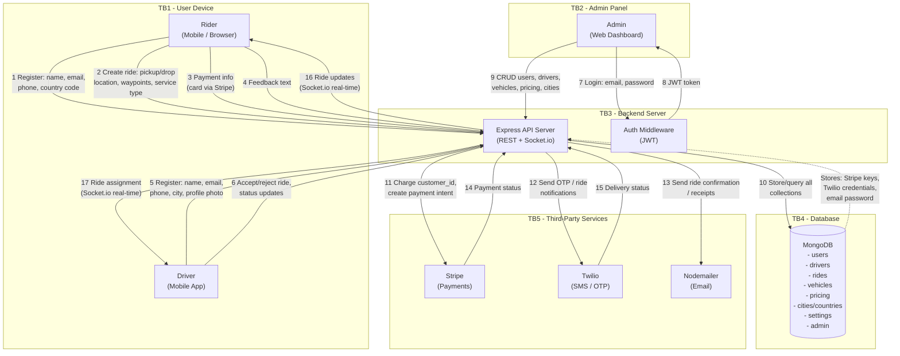

# Eber-Ride Data Flow Diagram

## System Overview

Eber-Ride is a ride-hailing application (Node.js/Express backend, Angular frontend, MongoDB database) with Stripe payments, Twilio SMS, and email notifications.

## DFD (Mermaid)

## Data Inventory

| Data Category | Storage | Sensitivity |
|---|---|---|
| User PII (name, email, phone) | MongoDB `users` | High |
| Driver PII (name, email, phone, city) | MongoDB `drivers` | High |
| Admin credentials (email, password stored in plaintext) | MongoDB `admin` | Critical |
| Ride details (locations, timestamps, fare) | MongoDB `rides` | High |
| Payment info (Stripe customer_id) | MongoDB `users` + Stripe | High |
| Vehicle info (name, image) | MongoDB `vehicles` | Low |
| Pricing config (fares, driver profit %) | MongoDB `pricing` | Medium |
| API keys (Stripe, Twilio, email password) | MongoDB `settings` | Critical |
| Feedback text | MongoDB `rides` | Low |
| Geographic data (cities, countries) | MongoDB `cities/countries` | Low |
